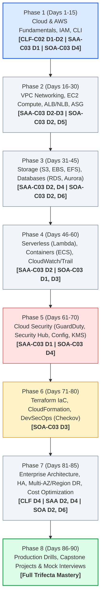

# 🚀 AWS Master Learning Dashboard & 90-Day Roadmap

> **The Cloud Engineer, Solutions Architect & CloudOps Specialist Handbook**  
> **Student Profile:** Fresher / Transitioning from QRadar SOC Administration  
> **Target Roles:** AWS Cloud Engineer / Cloud Security Engineer / DevSecOps Engineer  
> **Certifications Covered:**  
> 🎓 **CLF-C02:** AWS Certified Cloud Practitioner  
> 🎓 **SAA-C03:** AWS Certified Solutions Architect – Associate  
> 🎓 **SOA-C03:** AWS Certified CloudOps Engineer – Associate *(formerly SysOps Administrator)*  
> **Methodology:** Concept → Architecture → Configuration → Security → Lab → Troubleshooting → Production → Interview  

---

## 📸 Integrated Certification Strategy

*Figure 0.1: Triple-Threat Certification Alignment — CLF-C02 (Foundations), SAA-C03 (Architectural Design), SOA-C03 (Deep Operations & Troubleshooting)*

---

## 📊 Live Competency & Progress Tracker

| Domain | Current Level | Confidence | Target Level | Trifecta Alignment | Status |
| :--- | :---: | :---: | :---: | :---: | :---: |
| **AWS & Cloud Fundamentals** | **1 (Beginner)** | 🟡 Developing | **4 (Production Ready)** | CLF (D1-D4), SAA (D1-D4), SOA (D1-D6) | 🔄 In Progress |
| **IAM & Identity Governance** | **0 (Not Started)** | ⚪ None | **5 (Advanced / Security)** | CLF (D2), SAA (D1), SOA (D4) | ⏳ Queued |
| **VPC & Cloud Networking** | **0 (Not Started)** | ⚪ None | **5 (Advanced)** | CLF (D3), SAA (D1, D3), SOA (D5) | ⏳ Queued |
| **EC2, Compute & Scaling** | **0 (Not Started)** | ⚪ None | **4 (Production Ready)** | CLF (D3), SAA (D2, D3), SOA (D2, D3) | ⏳ Queued |
| **Storage (S3, EBS, EFS)** | **0 (Not Started)** | ⚪ None | **4 (Production Ready)** | CLF (D3), SAA (D2, D4), SOA (D2, D6) | ⏳ Queued |
| **Databases (RDS, Aurora, DynamoDB)** | **0 (Not Started)** | ⚪ None | **4 (Production Ready)** | CLF (D3), SAA (D2, D3), SOA (D2) | ⏳ Queued |
| **Serverless & Containers** | **0 (Not Started)** | ⚪ None | **3 (Intermediate)** | CLF (D3), SAA (D2), SOA (D3) | ⏳ Queued |
| **Observability (CloudWatch, CloudTrail)** | **1 (SOC Base)** | 🟡 Developing | **5 (Advanced / SIEM Integration)** | CLF (D2), SAA (D1), SOA (D1) | ⏳ Queued |
| **Cloud Security (GuardDuty, Security Hub)** | **1 (SOC Base)** | 🟡 Developing | **5 (Specialist)** | CLF (D2), SAA (D1), SOA (D4) | ⏳ Queued |
| **Terraform & Automation (IaC / CloudFormation)** | **0 (Not Started)** | ⚪ None | **4 (Production Ready)** | SAA (D2), SOA (D3) | ⏳ Queued |
| **Troubleshooting & Incident Response** | **1 (SOC Base)** | 🟡 Developing | **4 (Production Ready)** | SOA (D1, D5), SAA (D2) | ⏳ Queued |

*Proficiency Scale: 0 = Not Started | 1 = Beginner | 2 = Basic | 3 = Intermediate | 4 = Production Ready | 5 = Advanced Specialist*

---

## 🗺️ The 90-Day Enterprise Roadmap

---

## 📂 Curriculum Index & Exam Mappings

* **[Comprehensive Certification Trifecta Blueprint Mapping](01_AWS_Certifications_Trifecta_Syllabus_Mapping.md)**
* **[Phase 1 - Chapter 01: Cloud Computing & AWS Global Infrastructure](../01%20-%20Phase%201%20-%20Cloud%20&%20AWS%20Fundamentals/Chapter_01_Cloud_Computing_and_Global_Infrastructure.md)** *(CLF D1, D3 | SAA D2 | SOA D2)*
* Phase 1 - Chapter 02: The AWS Shared Responsibility Model & Security Pillars *(CLF D2 | SAA D1 | SOA D4)*
* Phase 1 - Chapter 03: AWS Management Interfaces & The AWS CLI *(CLF D3 | SOA D3)*
* Phase 1 - Chapter 04: IAM Fundamentals: Users, Groups, Roles, Policies & STS *(CLF D2 | SAA D1 | SOA D4)*
