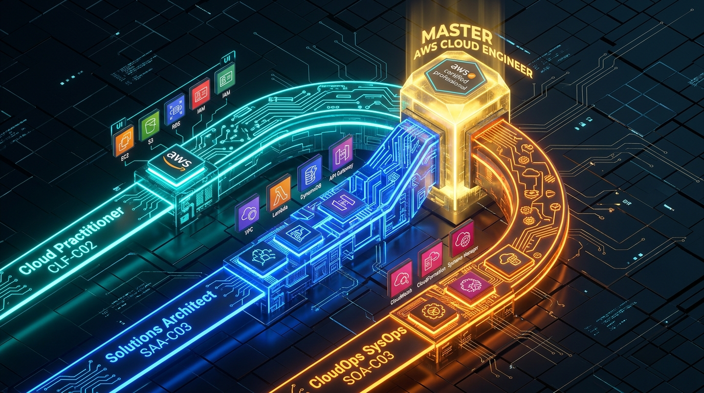

# 🎯 AWS Certification Trifecta: Full Syllabus & Domain Cross-Walk

> **Exam Alignment:**  
> 1. **CLF-C02:** AWS Certified Cloud Practitioner  
> 2. **SAA-C03:** AWS Certified Solutions Architect – Associate  
> 3. **SOA-C03:** AWS Certified CloudOps Engineer – Associate *(formerly SysOps Administrator)*  
>
> **Core Objective:** Every lesson, note, lab, and troubleshooting drill in this knowledge base seamlessly satisfies the strict exam blueprints of all three certifications while preserving 100% production and security depth.

---

## 📸 1. Visual Overview: The Associate Cloud Engineering Trifecta


*Figure 1.3: Convergence of Foundational Knowledge (CLF-C02), Resilient Architectural Design (SAA-C03), and Hands-on Operations & Troubleshooting (SOA-C03) into a single Production Master Engineer profile (`![[03_aws_exam_trifecta_matrix_3d.jpg]]`)*

---

## 🧭 2. The Certification Cross-Walk Matrix

Understanding how the three certifications intersect prevents redundant studying. We study each topic through all three perspectives at once:

```text
┌─────────────────────────┬─────────────────────────┬─────────────────────────┐
│     CLF-C02 (Concept)   │     SAA-C03 (Design)    │    SOA-C03 (Operations) │
│  "What is this service  │   "How do we architect  │ "How do we monitor, fix │
│   and what does it cost?"│   it for high resiliency│  automate, and patch it │
│                         │   and low latency?"     │  when it breaks at 3 AM?│
├─────────────────────────┼─────────────────────────┼─────────────────────────┤
│ Example: Amazon EC2     │ Example: Multi-AZ Auto  │ Example: EC2 CloudWatch │
│ Virtual machine in the  │ Scaling Group behind an │ alarms, SSM Run Command,│
│ cloud with EBS storage  │ ALB with cross-zone load│ failed health checks,   │
│ and pay-as-you-go billing│ balancing and Spot mix. │ AMI patching lifecycle. │
└─────────────────────────┴─────────────────────────┴─────────────────────────┘
```

---

## 📋 3. Detailed Exam Blueprints & Domain Mapping

### 🔷 Path 1: AWS Certified Cloud Practitioner (CLF-C02)
* **Domain 1: Cloud Concepts (24%)**
  * AWS Cloud value proposition, financial benefits (CapEx vs OpEx, TCO).
  * Cloud deployment models (Public, Private, Hybrid).
  * Well-Architected Framework 6 Pillars (Operational Excellence, Security, Reliability, Performance Efficiency, Cost Optimization, Sustainability).
* **Domain 2: Security and Compliance (30%)**
  * Shared Responsibility Model (IaaS, PaaS, SaaS demarcation).
  * IAM governance: Root user protection, MFA, IAM policies, access keys vs temporary credentials.
  * Security services: AWS WAF, AWS Shield, Amazon GuardDuty, AWS Security Hub, Amazon Inspector, AWS KMS.
  * Compliance and governance: AWS Artifact, AWS Audit Manager.
* **Domain 3: Cloud Technology and Services (34%)**
  * Global Infrastructure: Regions, Availability Zones, Edge Locations, Local Zones, Wavelength.
  * Compute: EC2, Lambda, ECS, Fargate, Elastic Beanstalk, Lightsail.
  * Storage: S3 classes, EBS volume types, EFS, AWS Backup, Storage Gateway.
  * Networking: VPC, Subnets, Internet Gateways, NAT Gateways, Security Groups, NACLs, Route 53, CloudFront.
  * Databases: RDS engines, Aurora, DynamoDB, ElastiCache, Redshift.
* **Domain 4: Billing, Pricing, and Support (12%)**
  * Pricing models: On-Demand, Reserved Instances, Savings Plans, Spot Instances.
  * Cost tooling: AWS Cost Explorer, AWS Budgets, Cost & Usage Report (CUR), Cost Allocation Tags.
  * AWS Support Plans: Basic, Developer, Business, Enterprise On-Ramp, Enterprise.
  * Migration: AWS Migration Evaluator, Cloud Adoption Framework (CAF).

---

### 🔷 Path 2: AWS Certified Solutions Architect – Associate (SAA-C03)
* **Domain 1: Design Secure Architectures (30%)**
  * Secure access to AWS resources (IAM roles, IAM permission boundaries, SCPs in AWS Organizations).
  * Secure workloads and applications (Security Groups, NACLs, AWS WAF, Shield Advanced).
  * Data security: KMS customer managed keys (CMK), envelope encryption, Secrets Manager, S3 bucket policies, VPC endpoints (PrivateLink).
* **Domain 2: Design Resilient Architectures (26%)**
  * Scalable, loosely coupled architectures: SQS, SNS, EventBridge, Step Functions.
  * Highly Available compute and storage: Multi-AZ Auto Scaling Groups, Application Load Balancers (ALB), Network Load Balancers (NLB).
  * Database resiliency: Amazon Aurora global databases, RDS Multi-AZ vs Read Replicas, DynamoDB Global Tables.
  * Disaster Recovery strategies: Backup & Restore, Pilot Light, Warm Standby, Multi-Site Active/Active; RTO and RPO calculations.
* **Domain 3: Design High-Performing Architectures (24%)**
  * High-performance storage: EBS io2 Block Express, EFS provisioned throughput, FSx for Lustre.
  * Elastic compute: Spot instance fleets, EC2 Placement Groups (Cluster, Spread, Partition).
  * Caching layers: ElastiCache (Redis/Memcached), CloudFront origin request policies, Global Accelerator.
  * Networking: AWS Direct Connect, Transit Gateway, Jumbo frames, SR-IOV (Enhanced Networking).
* **Domain 4: Design Cost-Optimized Architectures (20%)**
  * Storage lifecycle tiers: S3 Intelligent-Tiering, Glacier Flexible & Deep Archive, lifecycle expiration rules.
  * Compute cost tuning: Compute Savings Plans, Graviton (ARM) processors, Auto Scaling predictive scaling.
  * Data transfer cost mitigation: Keeping traffic within the same AZ, VPC Gateway Endpoints for S3/DynamoDB (zero data transfer fee).

---

### 🔷 Path 3: AWS Certified CloudOps Engineer – Associate (SOA-C03)
* **Domain 1: Monitoring, Logging, and Remediation (20%)**
  * CloudWatch Metrics, Alarms, Logs Insights, Metric Math, Synthetic Canaries.
  * Event-driven remediation: EventBridge rule triggering Systems Manager Automation or Lambda.
  * Centralized audit logging: CloudTrail multi-region organization trails, log file integrity validation.
  * Flow telemetry: VPC Flow Logs analysis (`ACCEPT` vs `REJECT`), filtering by ENI, subnet, or VPC.
* **Domain 2: Reliability and Business Continuity (16%)**
  * Scalability operations: ASG scaling policies (Target Tracking, Step, Simple), cooldown periods, lifecycle hooks.
  * Backup lifecycle: AWS Backup plans, cross-account and cross-region backup vault replication.
  * Disaster recovery execution: RDS point-in-time restore (PITR), Aurora automated snapshot restore, Route 53 DNS failover routing.
* **Domain 3: Deployment, Provisioning, and Automation (18%)**
  * Infrastructure provisioning: AWS CloudFormation stacks, change sets, drift detection, stack policies, nested stacks.
  * Systems Manager (SSM): Fleet Manager, Patch Manager (Patch Baselines), Run Command, Session Manager (SSH replacement), State Manager.
  * AMI lifecycle: EC2 Image Builder pipelines.
* **Domain 4: Security and Compliance (16%)**
  * AWS Config: Managed rules, custom rules, conformance packs, auto-remediation documents.
  * Vulnerability operations: Amazon Inspector automated vulnerability scanning for EC2, ECR, and Lambda.
  * Certificate management: AWS Certificate Manager (ACM) private and public certificate renewal.
  * Threat detection: GuardDuty finding suppression rules, Security Hub compliance standards (CIS AWS Foundations Benchmark).
* **Domain 5: Networking and Content Delivery (18%)**
  * Troubleshooting network connectivity: Route table target mismatch, NACL outbound ephemeral port blocks (ports 1024–65535), Security Group stateful evaluation.
  * VPC Endpoints: Resolving private connectivity issues between EC2 and S3/DynamoDB via Gateway Endpoints and Interface Endpoints.
  * Route 53 DNS record routing: Latency, Weighted, Geolocation, Geoproximity, Multi-Value Answer, Failover.
* **Domain 6: Cost and Performance Optimization (12%)**
  * Rightsizing underutilized resources using AWS Compute Optimizer and Trusted Advisor.
  * Cost anomaly detection: AWS Cost Anomaly Detection monitors and alerts.
  * EBS volume modifications: Modifying volume size, IOPS, and type dynamically using EBS Elastic Volumes without instance downtime.

---

## 🛠️ How Every Chapter in Our Notes Integrates This Trifecta

Whenever we study an AWS topic, each chapter is systematically tagged with:
1. **[CLF-C02 Foundational Concept]:** Clear definitions, business value, billing tiers.
2. **[SAA-C03 Solution Architecture]:** Multi-tier HA designs, fault tolerance, scalability, cost-effective service choice.
3. **[SOA-C03 CloudOps & Troubleshooting]:** CLI commands, CloudWatch metrics, SSM automation, failure scenarios, and root cause analysis (RCA).
