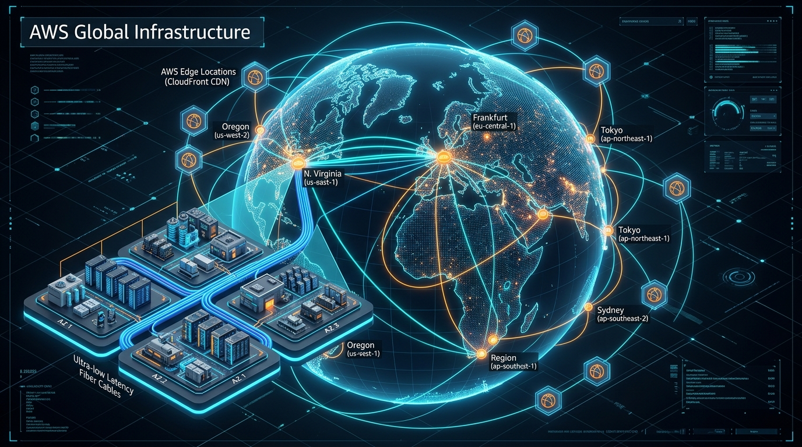
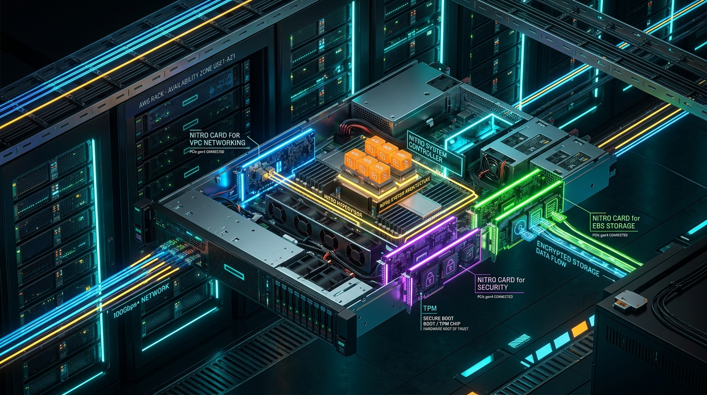
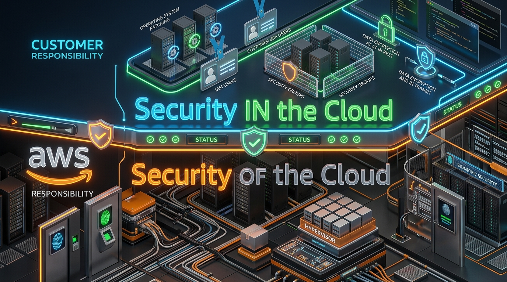
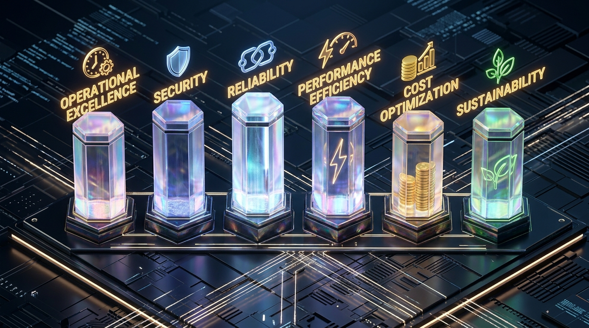

# 📖 Chapter 01: Cloud Computing, Global Infrastructure & Under-the-Hood Architecture

> **The AWS Cloud & Security Architect's Handbook** | Phase 1: Fundamentals  
> **Exam Alignment:**  
> • **CLF-C02:** Domain 1 (Cloud Concepts) & Domain 3 (Cloud Technology and Services)  
> • **SAA-C03:** Domain 2 (Design Resilient Architectures) & Domain 4 (Cost-Optimized Architectures)  
> • **SOA-C03:** Domain 2 (Reliability & Business Continuity) & Domain 5 (Networking & Content Delivery)  
> **Target Audience:** Complete Beginners to Enterprise Cloud Engineers & CloudOps Specialists  
> **Prerequisites:** None (Zero cloud background assumed; leverages IT/SOC familiarity)  
> **Official AWS Documentation References:**  
> • [AWS Global Infrastructure](https://aws.amazon.com/about-aws/global-infrastructure/)  
> • [AWS Regions and Availability Zones](https://aws.amazon.com/about-aws/global-infrastructure/regions_az/)  
> • [AWS Nitro System Architecture](https://aws.amazon.com/ec2/nitro/)  
> • [AWS Shared Responsibility Model](https://aws.amazon.com/compliance/shared-responsibility-model/)  
> • [AWS Well-Architected Framework](https://aws.amazon.com/architecture/well-architected/)  
> • [AWS Local Zones](https://aws.amazon.com/about-aws/global-infrastructure/localzones/)  
> • [AWS Wavelength](https://aws.amazon.com/wavelength/)

---

## 📸 1. Visual Overview: The AWS Global Infrastructure


*Figure 1.1: Isometric 3D rendering of the AWS Global Backbone: Globally distributed AWS Regions, multi-AZ clusters with low-latency fiber interconnection, and planetary Edge Locations (`![[01_aws_global_infra_3d.jpg]]`)*

---

## 2. What is Cloud Computing?

### 🍕 The Pizza Shop Analogy (Beginner's Lens)
* **On-Premises IT (Traditional):** You purchase commercial land, construct a brick-and-mortar restaurant, install industrial gas lines, buy ovens, hire physical security guards, and install backup diesel generators. If your business fails in three months, you suffer massive capital loss (**CapEx**). If 10,000 customers unexpectedly arrive on Friday, you run out of ovens and lose revenue.
* **Cloud Computing (AWS):** You rent a commercial kitchen workspace on demand by the minute. Need 2 ovens today? You pay for 2. A festival happens tomorrow? You spin up 50 ovens in 60 seconds. The festival ends? You terminate 48 ovens and stop paying immediately (**OpEx**).

```text
┌────────────────────────────────────────────────────────────────────────┐
│                        TRADITIONAL ON-PREM vs AWS                      │
│                                                                        │
│   On-Premises:  Procure Hardware ──► 6-8 Weeks Delivery ──► Install    │
│                 (High CapEx, Idle Capacity, Slow Innovation)          │
│                                                                        │
│   AWS Cloud:    Authenticated API Call ──► Provisioned in 30 Seconds   │
│                 (Pay-as-you-go OpEx, Infinite Elasticity)             │
└────────────────────────────────────────────────────────────────────────┘
```

---

## 📸 3. Under the Hood: The AWS Nitro System Architecture

How does AWS actually run virtual instances without sacrificing performance, security, or hardware resources?


*Figure 1.2: Cutaway 3D view of an AWS enterprise host blade powered by the AWS Nitro System — dedicated ASIC cards offloading VPC networking, EBS storage, and cryptographic security from the CPU (`![[04_aws_nitro_system_3d.jpg]]`)*

### 🔬 What is the AWS Nitro System? (Crucial for SAA-C03 / SOA-C03 & Interviews)
*Official Reference: [AWS Nitro System Overview](https://aws.amazon.com/ec2/nitro/)*

In legacy hypervisors (e.g., traditional VMware ESXi or Xen), **15% to 30% of the host server's CPU and memory** is wasted managing networking, storage IOPS, and hypervisor virtualization overhead.

AWS invented the **AWS Nitro System**, which offloads almost all virtualization, networking, and storage processing onto custom-built, dedicated hardware ASIC PCIe cards (**Nitro Cards**):

1. **Nitro Card for VPC:** Handles software-defined networking, Virtual Private Cloud (VPC) packet encapsulation, Security Group firewall rule processing, and provides up to **100 Gbps - 400 Gbps** of network throughput (ENA - Elastic Network Adapter) with negligible CPU impact.
2. **Nitro Card for EBS:** Acts as a dedicated high-performance NVMe storage controller connecting the host over high-speed networks to Amazon Elastic Block Store (EBS), managing transparent AES-256 hardware encryption in real time.
3. **Nitro Card for Security (Hardware Root of Trust):** Houses a dedicated **Trusted Platform Module (TPM)** chip that enforces cryptographic secure boot, verifies firmware integrity on every boot cycle, and physically prevents AWS technicians or unauthorized firmware from modifying system memory.
4. **Nitro Hypervisor:** A microscopic, lightweight firmware hypervisor that simply allocates host memory and CPU cores. It provides bare-metal-equivalent performance and zero host-level access (even Amazon engineers cannot log in to an active Nitro host server).

```text
┌──────────────────────────────────────────────────────────────────────────────┐
│                    PHYSICAL AWS HOST (THE NITRO ARCHITECTURE)                │
│                                                                              │
│  ┌─────────────────────────┐  ┌─────────────────────────┐                    │
│  │ Guest EC2 Instance #1   │  │ Guest EC2 Instance #2   │ (Nearly 100% of    │
│  │ (Customer Linux/Windows)│  │ (Customer Linux/Windows)│  CPU & RAM devoted │
│  └────────────┬────────────┘  └────────────┬────────────┘  to Customer VMs)  │
│               │                            │                                 │
│  ═════════════╪════════════════════════════╪══════════════════════════════   │
│               ▼                            ▼                                 │
│     [ Ultra-Lightweight Nitro Hypervisor (Memory & CPU core slicing) ]       │
│  ═════════════╤════════════════════════════╤══════════════════════════════   │
│               │ (Dedicated PCIe Offload)   │                                 │
│               ▼                            ▼                                 │
│  ┌──────────────────────────┐ ┌──────────────────────────┐                   │
│  │ Nitro Card for VPC       │ │ Nitro Card for EBS       │                   │
│  │ Encapsulation, SG rules, │ │ Dedicated NVMe controller│                   │
│  │ up to 400 Gbps ENA       │ │ Transparent Encryption   │                   │
│  └──────────────────────────┘ └──────────────────────────┘                   │
│  ┌──────────────────────────┐ ┌──────────────────────────┐                   │
│  │ Nitro Card for Storage   │ │ Nitro Security Chip      │                   │
│  │ Local NVMe Instance Store│ │ Hardware Root of Trust,  │                   │
│  │ flash array management   │ │ Secure Boot TPM, Locked  │                   │
│  └──────────────────────────┘ └──────────────────────────┘                   │
└──────────────────────────────────────────────────────────────────────────────┘
```

---

## 4. The 3 Cloud Service Models & The 6 Advantages of Cloud

### 📦 The 3 Cloud Service Models
*Official Reference: [Types of Cloud Computing](https://aws.amazon.com/what-is-cloud-computing/)*

| Model | What AWS Manages | What You Manage | Real-World AWS Example | Exam Relevance |
| :--- | :--- | :--- | :--- | :--- |
| **IaaS** *(Infrastructure as a Service)* | Physical data centers, host hardware, virtualization hypervisor, physical network. | OS patching, application software, firewalls (Security Groups), customer data, network routing. | **Amazon EC2, Amazon EBS** | **CLF-C02 / SOA-C03:** High operational maintenance, full OS-level control. |
| **PaaS** *(Platform as a Service)* | Physical hardware, virtualization, OS provisioning, OS security patching, database engine binaries. | Application code, database schema, environment variables, access policies. | **AWS Elastic Beanstalk, Amazon RDS** | **CLF-C02 / SAA-C03:** Faster time-to-market, automated patching and backups. |
| **SaaS** *(Software as a Service)* | Entire stack: hardware, hypervisor, OS, application uptime, software updates, scaling. | User identity access and your stored data. | **AWS QuickSight, Salesforce, Microsoft 365** | **CLF-C02:** Fully managed end-user software. |

### 🏆 The 6 Advantages of Cloud Computing (Core CLF-C02 Exam Topic)
*Official Reference: [6 Advantages of Cloud Computing](https://docs.aws.amazon.com/whitepapers/latest/aws-overview/six-advantages-of-cloud-computing.html)*

1. **Trade Capital Expense (CapEx) for Variable Expense (OpEx):** Pay only for what you consume instead of massive upfront hardware investments.
2. **Benefit from Massive Economies of Scale:** AWS aggregates hundreds of thousands of customers, driving lower wholesale prices that translate into continuous price reductions.
3. **Stop Guessing Capacity:** Scale up or down automatically based on real-time load, eliminating idle servers or crashed services.
4. **Increase Speed and Agility:** Spin up compute, database, or machine learning resources in seconds rather than waiting months for procurement.
5. **Stop Spending Money Running and Maintaining Data Centers:** Focus your engineering teams on business software and security, not racking servers, repairing cooling units, or paying electric bills.
6. **Go Global in Minutes:** Deploy applications across multiple geographic regions worldwide with a few clicks, slashing latency for end users.

---

## 5. AWS Global Infrastructure: Regions, AZs & Edge Locations

*Official Reference: [AWS Global Infrastructure Map & Data](https://aws.amazon.com/about-aws/global-infrastructure/regions_az/)*

```
[ AWS Global Backbone Network: Redundant 100 GbE Trans-Oceanic Fiber ]
                               │
       ┌───────────────────────┴───────────────────────┐
       │ AWS Region: us-east-1 (N. Virginia)           │
       │                                               │
       │  ┌─────────────────┐     ┌─────────────────┐  │
       │  │    AZ us-east-1a│     │    AZ us-east-1b│  │  Inter-AZ Latency
       │  │  ┌───────────┐  │◄───►│  ┌───────────┐  │  │  < 1-2 ms
       │  │  │ Data Ctr 1│  │     │  │ Data Ctr 1│  │  │  Synchronous
       │  │  │ Data Ctr 2│  │     │  │ Data Ctr 2│  │  │  Replication
       │  │  └───────────┘  │     │  └───────────┘  │  │
       │  └─────────────────┘     └─────────────────┘  │
       └───────────────────────────────────────────────┘
                               │
                 ┌─────────────┴─────────────┐
                 ▼                           ▼
          [ Edge Location ]           [ Edge Location ]
          London (CloudFront)         Mumbai (CloudFront)
```

### A. AWS Region
* A geographical area containing a cluster of data centers (e.g., `us-east-1` in N. Virginia, `ap-south-1` in Mumbai, `eu-west-1` in Ireland).
* **Isolation Rule:** Every AWS Region is completely independent and autonomous. An outage in `us-east-1` has zero direct architectural impact on `eu-west-1`.
* **Selection Criteria (Crucial for SAA-C03 & CLF-C02):** 
  1. **Compliance / Data Sovereignty:** Legal requirements (e.g., GDPR requires EU citizen data to remain in the EU; German financial regulations require `eu-central-1`).
  2. **Latency:** Choosing a region closest to your primary user base to minimize round-trip network times.
  3. **Service Availability:** Some brand-new AWS services launch first in `us-east-1` or `us-west-2` before rolling out worldwide.
  4. **Cost:** AWS resource pricing differs by region due to local power, tax, and labor costs (e.g., `us-east-1` is generally cheaper than `sa-east-1` São Paulo).

### B. Availability Zone (AZ)
* Each Region contains **at least 3 (and up to 6) Availability Zones**.
* An AZ is **one or more discrete physical data centers**, each with independent redundant power grids, cooling infrastructure, and networking.
* AZs are physically separated by meaningful distances (typically 10 to 60 miles) to safeguard against localized flooding, fires, or utility outages, but connected via private, low-latency (< 2 ms) high-bandwidth fiber optic cables.
* *Naming Standard:* Region code + lowercase letter (e.g., `us-east-1a`, `us-east-1b`, `us-east-1c`).

> ⚠️ **Critical AWS Production & CloudOps Fact (AZ ID vs Zone Name):**  
> To ensure resource distribution across physical data centers, AWS maps AZ identifiers dynamically per account! Your `us-east-1a` might physically point to a different building than another company's `us-east-1a`. To coordinate physical locations across enterprise accounts or AWS Organizations, CloudOps engineers must reference the immutable **AZ ID** (e.g., `use1-az1`). *(Regularly tested on SOA-C03 & SAA-C03)*.  
> *Reference: [AWS AZ ID Documentation](https://docs.aws.amazon.com/ram/latest/userguide/working-with-az-ids.html)*

### C. Edge Locations & Points of Presence (PoPs)
* 600+ geographically dispersed mini-datacenters located in major metropolitan areas worldwide.
* They host **Amazon CloudFront** (Content Delivery Network - CDN), **Amazon Route 53** (DNS), and **AWS Global Accelerator**.
* **Purpose:** Cache static and streaming web assets (images, CSS, video chunks) as close as possible to the user, terminating TLS connections at the edge and routing traffic back to the origin over AWS's private congestion-free fiber backbone.

### D. AWS Local Zones & AWS Wavelength
* **AWS Local Zones:** Extends an AWS Region to place compute, storage, and database services close to large population or industry centers where no full AWS Region exists (e.g., Los Angeles, Chicago) for single-digit millisecond latency. Ref: [AWS Local Zones](https://aws.amazon.com/about-aws/global-infrastructure/localzones/)
* **AWS Wavelength:** Embeds AWS compute and storage services directly inside telecommunications providers' **5G networks** (e.g., Verizon, Vodafone) for ultra-low latency mobile edge computing (autonomous vehicles, smart factories, AR/VR). Ref: [AWS Wavelength](https://aws.amazon.com/wavelength/)

---

## 📸 6. The AWS Shared Responsibility Model


*Figure 1.3: The Security Boundary: "Security OF the Cloud" (AWS responsibility) vs "Security IN the Cloud" (Customer responsibility) (`![[02_aws_shared_responsibility_3d.jpg]]`)*

*Official Reference: [AWS Shared Responsibility Model](https://aws.amazon.com/compliance/shared-responsibility-model/)*

### 🛡️ Detailed Boundary Matrix

```text
┌─────────────────────────────────────────────────────────────────────────────┐
│                       CUSTOMER: Security "IN" the Cloud                     │
│                                                                             │
│   • Customer Data (Classification, Integrity, Lifecycle)                   │
│   • Identity & Access Management (IAM Users, Roles, MFA, Least Privilege)   │
│   • Operating System Configuration & Security Patching (EC2)                │
│   • Network & Firewall Configuration (Security Groups, NACLs, VPC Routing)  │
│   • Client-Side & Server-Side Data Encryption (KMS keys, TLS/SSL)           │
└─────────────────────────────────────────────────────────────────────────────┘
═════════════════════════ THE SECURITY BOUNDARY LINE ══════════════════════════
┌─────────────────────────────────────────────────────────────────────────────┐
│                          AWS: Security "OF" the Cloud                       │
│                                                                             │
│   • Physical Data Center Security (Biometrics, Armed Guards, CCTV, Fencing)  │
│   • Environmental Controls (HVAC, Fire Suppression, Uninterruptible Power)   │
│   • Physical Hardware Lifecycle & Secure Disk Decommissioning (DoD 5220.22-M)│
│   • Virtualization Layer (Hypervisor Isolation, Host OS, AWS Nitro System)  │
│   • Physical Network Infrastructure (Routers, Switches, Undersea Cables)    │
└─────────────────────────────────────────────────────────────────────────────┘
```

---

## 📸 7. The AWS Well-Architected Framework: The 6 Pillars

Every enterprise solution architecture and exam scenario on SAA-C03 and SOA-C03 is evaluated against the **AWS Well-Architected Framework**.


*Figure 1.4: The 6 Foundation Pillars of AWS Well-Architected Engineering (`![[05_aws_well_architected_pillars_3d.jpg]]`)*

*Official Reference: [AWS Well-Architected Framework Whitepaper](https://docs.aws.amazon.com/wellarchitected/latest/framework/welcome.html)*

### 🏛️ The 6 Pillars Broken Down

| Pillar | Core Mission | Key Design Principles & Services |
| :--- | :--- | :--- |
| **1. Operational Excellence** | Run and monitor systems, continually improve processes and procedures. | • Perform operations as code (**CloudFormation / Terraform**)<br>• Make frequent, small, reversible changes<br>• Anticipate failure; refine operations procedures frequently |
| **2. Security** | Protect data, systems, and assets while delivering business value through cloud technologies. | • Implement a strong identity foundation (**IAM, MFA, IAM Identity Center**)<br>• Enable traceability (**CloudTrail, CloudWatch, VPC Flow Logs**)<br>• Apply security at all layers (Defense in Depth)<br>• Automate security best practices (**AWS Config, GuardDuty**)<br>• Protect data in transit and at rest (**AWS KMS, TLS 1.3**) |
| **3. Reliability** | Prevent and quickly recover from failures to meet business and customer demand. | • Automatically recover from failure (**Auto Scaling, Route 53 Health Checks**)<br>• Test recovery procedures (**Disaster Recovery drills, Chaos Engineering**)<br>• Scale horizontally to increase aggregate workload availability<br>• Stop guessing capacity |
| **4. Performance Efficiency** | Use computing resources efficiently to meet system requirements, and maintain efficiency as demand changes. | • Democratize advanced technologies (use managed services like DynamoDB, RDS)<br>• Go global in minutes (**CloudFront, Route 53**)<br>• Use serverless architectures (**AWS Lambda, Fargate**)<br>• Experiment more frequently |
| **5. Cost Optimization** | Run systems to deliver business value at the lowest price point. | • Implement cloud financial management (**AWS Cost Explorer, AWS Budgets**)<br>• Adopt a consumption model (pay only for what you use)<br>• Measure overall efficiency; stop paying for idle resources<br>• Leverage tiered storage (**S3 Intelligent-Tiering, Glacier**) |
| **6. Sustainability** | Minimize the environmental impacts of running cloud workloads. | • Understand your impact (**AWS Customer Carbon Footprint Tool**)<br>• Maximize hardware utilization (**Graviton ARM processors**)<br>• Use managed services to share capacity; reduce idle compute |

---

## 🛠️ 8. AWS CLI: Hands-on Foundation (SOA-C03 CloudOps Essential)

As an AWS CloudOps Engineer, you rarely rely purely on the GUI Console. The AWS CLI gives you scriptable control over the AWS API.

### Essential CLI Commands to Inspect Global Infrastructure

```bash
# 1. List all available AWS Regions enabled on your account
aws ec2 describe-regions --output table

# 2. List all Availability Zones in your current configured region (e.g. us-east-1)
# Note the retrieval of both ZoneName (logical) and ZoneId (physical)!
aws ec2 describe-availability-zones \
    --region us-east-1 \
    --query "AvailabilityZones[].{ZoneName:ZoneName, ZoneId:ZoneId, State:State}" \
    --output table

# 3. Check your caller identity (Who am I authenticated as?)
aws sts get-caller-identity
```

### Expected Output Example:

```text
------------------------------------------------
|           DescribeAvailabilityZones          |
+--------------+------------------+------------+
|    State     |      ZoneId      |  ZoneName  |
+--------------+------------------+------------+
|  available   |  use1-az1        |  us-east-1a|
|  available   |  use1-az2        |  us-east-1b|
|  available   |  use1-az4        |  us-east-1c|
+--------------+------------------+------------+
```

---

## 💥 9. Production Troubleshooting & Failure Scenarios (CloudOps Drill)

### Scenario: The Single-AZ Blackout
* **Incident:** An e-commerce company deployed their web application servers and MySQL database exclusively in `us-east-1a`. A severe utility substation failure hits that AZ's data center cluster.
* **Symptom:** Web application returns `HTTP 504 Gateway Timeout`. Application is completely offline.
* **Root Cause Analysis (RCA):** Single Point of Failure (SPOF) architecture. No multi-AZ redundancy configured.
* **Remediation & SAA-C03 Architecture Design:**
  1. Distribute compute instances across a minimum of **two distinct AZs** (`us-east-1a` and `us-east-1b`) behind an **Application Load Balancer (ALB)**.
  2. Deploy databases using **Amazon RDS Multi-AZ**, which automatically provisions a synchronous standby replica in a different AZ and handles failover in 60–120 seconds if the primary AZ dies.

---

## 🗂️ 10. Master Flashcards (Trifecta Exam Focused)

### Card 1.1: AWS Region vs Availability Zone
* **Question:** What is the technical difference between an AWS Region and an Availability Zone (AZ)?
* **Interview / SAA-C03 Answer:** An AWS Region is an independent geographic area (e.g., `us-east-1`) containing multiple, physically isolated locations known as Availability Zones. An AZ consists of one or more discrete data centers equipped with independent power, cooling, and network redundancy, connected to other AZs in the same Region via high-bandwidth, ultra-low-latency fiber networks.
* **Production Context:** Production architectures mandate deploying workloads across at least two AZs within a Region to ensure High Availability (HA) and withstand physical data center disasters.

### Card 1.2: Shared Responsibility - EC2 vs S3
* **Question:** Who is responsible for data encryption on Amazon S3 and OS patching on Amazon EC2?
* **Interview / CLF-C02 Answer:** Under the AWS Shared Responsibility Model, the **customer** is responsible for both. For EC2 (IaaS), the customer owns the guest OS patching and software maintenance. For S3, while AWS secures the underlying physical storage media, the customer is responsible for enabling server-side encryption (SSE-S3 / SSE-KMS) and managing bucket access policies.

### Card 1.3: Zone Name vs Zone ID (CloudOps SOA-C03 Special)
* **Question:** Why can't two AWS accounts assume that `us-east-1a` refers to the exact same physical building?
* **Answer:** AWS dynamically maps the alphabetical Zone Names (`us-east-1a`, `1b`, etc.) independently for each account to evenly balance physical capacity across data centers. To guarantee that instances in different accounts reside in the exact same physical data center, engineers must align them using the immutable **Zone ID** (e.g., `use1-az1`).

### Card 1.4: AWS Nitro System
* **Question:** What architectural advantage does the AWS Nitro System provide over traditional hypervisors?
* **Answer:** Nitro offloads hypervisor overhead, software-defined networking (VPC), EBS encryption, and host security to dedicated PCIe hardware cards. This frees up virtually 100% of host CPU and memory for customer workloads while reinforcing security through a hardware root of trust (TPM).

---

## 🎯 11. Knowledge Check Quiz (Trifecta Preparation)

*Answer these 3 exam-style questions to test your grasp:*

1. **CLF-C02 / SAA-C03 Scenario:** A company wants to migrate an on-premises workload to AWS. They must comply with strict national data residency laws requiring all database records to remain inside the European Union. Which AWS infrastructure entity dictates compliance with this requirement?
   * A) Availability Zone
   * B) Edge Location
   * C) AWS Region
   * D) Placement Group

2. **SAA-C03 / SOA-C03 Scenario:** An enterprise has two separate AWS accounts (Production and Analytics). They want to configure high-bandwidth, low-latency private communication between EC2 instances in both accounts within the `us-east-1` region. How can the engineer ensure the EC2 instances in both accounts are provisioned in the exact same physical data center?
   * A) Launch both instances in `us-east-1a` in their respective accounts.
   * B) Verify and match the `ZoneId` (e.g., `use1-az2`) across both accounts.
   * C) Deploy both instances into AWS Local Zones.
   * D) Use CloudFront Edge Locations.

3. **CLF-C02 / Security Scenario:** A company suffers a ransomware attack that encrypts files on multiple Amazon EC2 Windows instances. The security audit reveals that Windows Defender was disabled and security patches had not been applied for 8 months. Under the AWS Shared Responsibility Model, who is accountable for this security failure and why?
